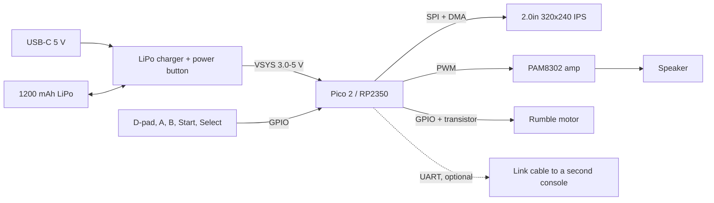

# JF Retro Game

Notes and a design for a home-built, battery-powered retro handheld games console
based on Raspberry Pi hardware, with its own original games. It has a screen, a
D-pad, buttons, a speaker and a rechargeable battery that charges over USB-C, and
it fits in a pocket.

**The aim is fun.** Every choice below is judged first by whether it makes the thing
more fun to pick up, play and show to a friend. Specs come second.

## The design in one paragraph

A **Raspberry Pi Pico 2** (RP2350) drives a **2.0-inch 320×240 IPS screen**. Games
draw at a chunky **160×120** and each pixel is doubled, which gives the retro look
and keeps the frame buffer small enough to hit 60 frames a second. Controls are a
D-pad, **A** and **B**, and **Start** and **Select** on tactile switches. Sound comes
from a small speaker through a class-D amplifier, and a coin-cell vibration motor
gives rumble. Power is a single **1200 mAh LiPo** cell with a USB charger and an
on/off button. That should give roughly ten hours of play, though this still has to
be measured. It is on and playing **in under a second** after you press the power
button. A 3D-printed case holds everything. The first build uses plug-together
boards from Pimoroni, so you can play a game before any soldering. Later builds move
to a hand-wired button board and a custom case.

## Documents

| # | Document | What it covers |
|---|----------|----------------|
| 1 | [What makes it fun](docs/01_what_makes_it_fun.md) | Design rules that come before any hardware choice |
| 2 | [Choosing the brain](docs/02_choosing_the_brain.md) | Pico, Pico 2, Pi Zero 2 W and Pi 5 compared; why the Pico 2 wins |
| 3 | [Power and battery](docs/03_power_and_battery.md) | LiPo cell, charging, on/off, battery gauge, run time, safety |
| 4 | [Screen and controls](docs/04_screen_and_controls.md) | Display choice, frame rate sums, buttons, layout |
| 5 | [Sound, rumble and extras](docs/05_sound_rumble_extras.md) | Speaker, vibration, link cable, tilt sensor |
| 6 | [Pin map and wiring](docs/06_pin_map_and_wiring.md) | Every GPIO used, and the wiring for each build stage |
| 7 | [Software](docs/07_software.md) | MicroPython first, C later; the game loop; saving high scores |
| 8 | [Game ideas](docs/08_game_ideas.md) | Original games designed for this console, with a launch title in detail |
| 9 | [Parts list](docs/09_parts_list.md) | Bill of materials with rough UK prices |
| 10 | [Build plan](docs/10_build_plan.md) | Stages from "playing on the desk" to "finished handheld" |
| 11 | [Selling it: the cost-down version](docs/11_selling_on_a_budget.md) | About £12 of parts per console: AA cells, a bare screen, a carrier PCB; price, profit and the rules to check |

## Start-up screen

The console's start-up animation ("powered by Raspberry Pi", then NEXUS) has its own repo,
[JF_NEXUS_startup](https://github.com/BrendanJamesLynskey/JF_NEXUS_startup), with MicroPython code for the
Pico and a [browser preview](https://brendanjameslynskey.github.io/JF_NEXUS_startup/).

## Status

Design notes only. Nothing has been bought or built yet.

The plan is to sell a batch. The version for sale runs on two AA rechargeable cells
and has a carrier PCB and a printed shell, for about £12 of parts. See
[Selling it](docs/11_selling_on_a_budget.md).

## Licence

Text and diagrams: [CC BY 4.0](https://creativecommons.org/licenses/by/4.0/).
